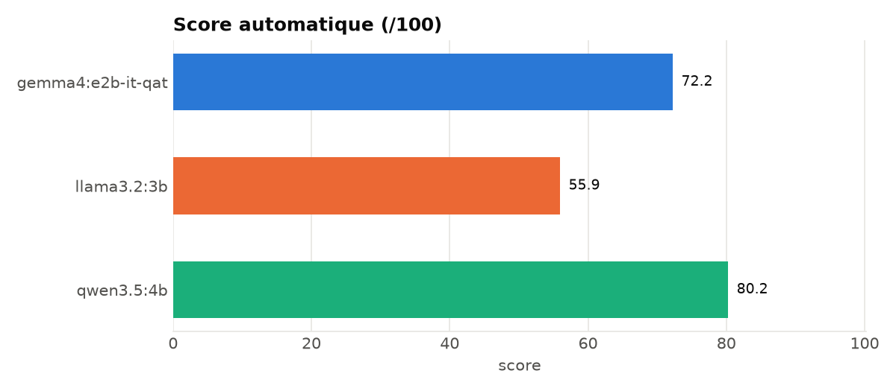
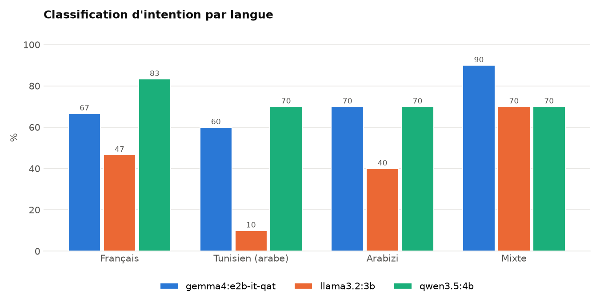
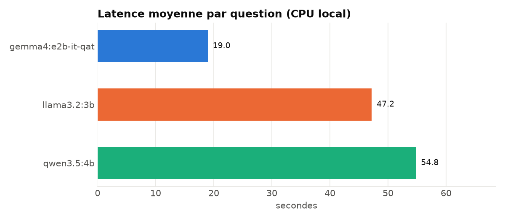
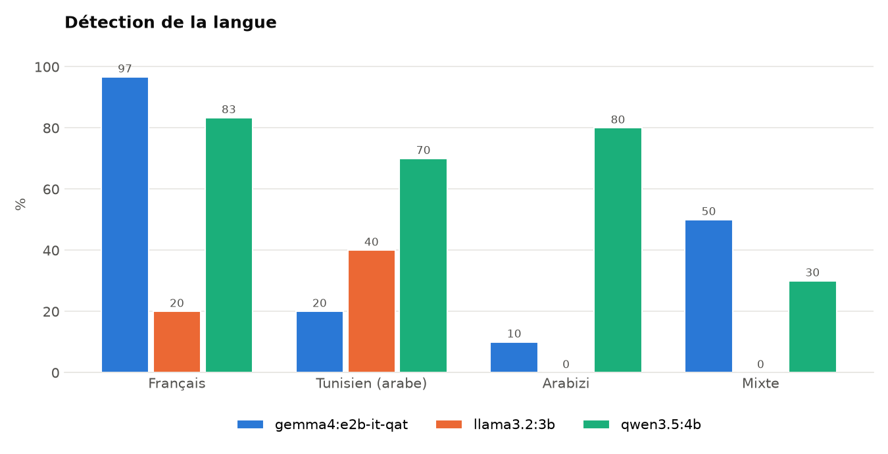
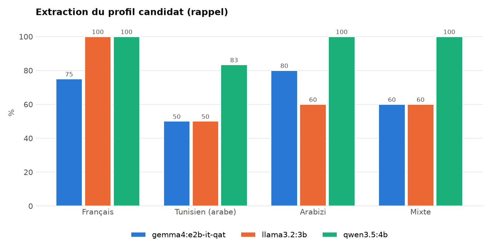
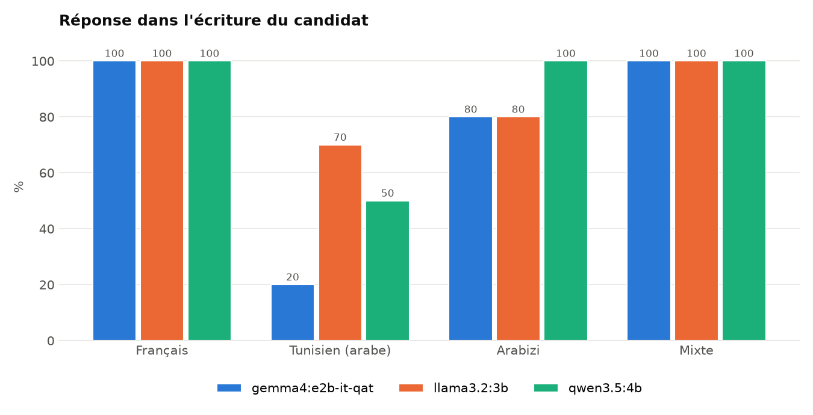

# Résultats SA-33 / SA-34 — Comparaison des LLM

Jeu d'évaluation : 60 questions × 3 modèles, inférence locale (Ollama, CPU), température 0.2, sortie JSON contrainte.

## SA-33 — Comparaison globale

| Modèle | Score /100 | Intention | F1 macro | Langue | Profil | Écriture réponse | Chiffres suspects ↓ | JSON valide | Latence (s) | tok/s |
|---|---|---|---|---|---|---|---|---|---|---|
| **qwen3.5:4b** | **80.2** | 77 % | 0.75 | 72 % | 97 % | 92 % | 36 % | 100 % | 54.8 | 4.5 |
| **gemma4:e2b-it-qat** | **72.2** | 70 % | 0.72 | 62 % | 68 % | 83 % | 14 % | 98 % | 19.0 | 6.5 |
| **llama3.2:3b** | **55.9** | 43 % | 0.39 | 17 % | 76 % | 92 % | 29 % | 95 % | 47.2 | 4.3 |

**Évaluation humaine** (fichier `a_annoter.csv`) :

| Modèle | Réponses annotées | Pertinence /5 | Registre OK | Hallucination ↓ |
|---|---|---|---|---|
| gemma4:e2b-it-qat | 40 | 3.33 | 57 % | 2 % |
| llama3.2:3b | 40 | 1.95 | 50 % | 32 % |
| qwen3.5:4b | 40 | 2.42 | 80 % | 45 % |

**Score final** (compréhension automatique + évaluation humaine) = 25 % intention + 10 % langue + 15 % profil + 10 % écriture + 20 % pertinence + 20 % fiabilité (1 − hallucination).

| Modèle | Score automatique /100 | **Score final /100** | Latence (s) |
|---|---|---|---|
| gemma4:e2b-it-qat | 72.2 | **73.3** | 19.0 |
| qwen3.5:4b | 80.2 | **68.2** | 54.8 |
| llama3.2:3b | 55.9 | **51.3** | 47.2 |

**Évaluation humaine par langue :**

| Modèle | Langue | Pertinence /5 | Registre OK | Hallucination ↓ |
|---|---|---|---|---|
| gemma4:e2b-it-qat | Français | 3.90 | 100 % | 0 % |
| gemma4:e2b-it-qat | Tunisien (arabe) | 2.60 | 10 % | 0 % |
| gemma4:e2b-it-qat | Arabizi | 3.10 | 30 % | 10 % |
| gemma4:e2b-it-qat | Mixte | 3.70 | 90 % | 0 % |
| llama3.2:3b | Français | 2.50 | 100 % | 50 % |
| llama3.2:3b | Tunisien (arabe) | 1.20 | 0 % | 30 % |
| llama3.2:3b | Arabizi | 1.70 | 0 % | 10 % |
| llama3.2:3b | Mixte | 2.40 | 100 % | 40 % |
| qwen3.5:4b | Français | 3.20 | 100 % | 60 % |
| qwen3.5:4b | Tunisien (arabe) | 1.60 | 40 % | 40 % |
| qwen3.5:4b | Arabizi | 2.10 | 80 % | 40 % |
| qwen3.5:4b | Mixte | 2.80 | 100 % | 40 % |

**Score global** = 30 % intention + 20 % langue + 20 % profil + 15 % écriture de la réponse + 15 % (1 − chiffres suspects).

**Modèle retenu (selon le score final) : `gemma4:e2b-it-qat`.**

### Matrices de confusion (intention attendue → prédite)

**gemma4:e2b-it-qat**

| attendue \ prédite | SALUTA | INFO_F | COMPAR | ORIENT | PROFIL | PREINS | HORS_S | (vide) |
|---|---|---|---|---|---|---|---|---|
| SALUTATION | 2 | 2 | · | · | · | · | · | · |
| INFO_FORMATION | · | 15 | 4 | 1 | · | · | · | 1 |
| COMPARAISON | · | · | 7 | · | · | · | · | · |
| ORIENTATION | · | 2 | 2 | 6 | · | · | · | · |
| PROFIL | · | · | · | 3 | 2 | · | · | · |
| PREINSCRIPTION | · | 2 | · | 1 | · | 7 | · | · |
| HORS_SUJET | · | · | · | · | · | · | 3 | · |

**llama3.2:3b**

| attendue \ prédite | SALUTA | INFO_F | COMPAR | ORIENT | PROFIL | PREINS | HORS_S | (vide) |
|---|---|---|---|---|---|---|---|---|
| SALUTATION | · | 1 | · | 3 | · | · | · | · |
| INFO_FORMATION | · | 12 | · | 5 | 4 | · | · | · |
| COMPARAISON | · | 2 | 2 | · | 1 | · | · | 2 |
| ORIENTATION | · | 4 | 2 | 3 | 1 | · | · | · |
| PROFIL | · | 1 | · | · | 4 | · | · | · |
| PREINSCRIPTION | · | 2 | · | 2 | 1 | 4 | · | 1 |
| HORS_SUJET | · | · | · | 1 | 1 | · | 1 | · |

**qwen3.5:4b**

| attendue \ prédite | SALUTA | INFO_F | COMPAR | ORIENT | PROFIL | PREINS | HORS_S |
|---|---|---|---|---|---|---|---|
| SALUTATION | 2 | 2 | · | · | · | · | · |
| INFO_FORMATION | · | 17 | 3 | 1 | · | · | · |
| COMPARAISON | · | · | 7 | · | · | · | · |
| ORIENTATION | · | · | 2 | 7 | 1 | · | · |
| PROFIL | · | · | · | 3 | 2 | · | · |
| PREINSCRIPTION | · | · | · | 2 | · | 8 | · |
| HORS_SUJET | · | · | · | · | · | · | 3 |

## SA-34 — Compréhension du dialecte tunisien et de l'Arabizi

| Modèle | Langue | Intention | Langue détectée | Profil | Écriture réponse |
|---|---|---|---|---|---|
| gemma4:e2b-it-qat | Français | 67 % | 97 % | 75 % | 100 % |
| gemma4:e2b-it-qat | Tunisien (arabe) | 60 % | 20 % | 50 % | 20 % |
| gemma4:e2b-it-qat | Arabizi | 70 % | 10 % | 80 % | 80 % |
| gemma4:e2b-it-qat | Mixte | 90 % | 50 % | 60 % | 100 % |
| llama3.2:3b | Français | 47 % | 20 % | 100 % | 100 % |
| llama3.2:3b | Tunisien (arabe) | 10 % | 40 % | 50 % | 70 % |
| llama3.2:3b | Arabizi | 40 % | 0 % | 60 % | 80 % |
| llama3.2:3b | Mixte | 70 % | 0 % | 60 % | 100 % |
| qwen3.5:4b | Français | 83 % | 83 % | 100 % | 100 % |
| qwen3.5:4b | Tunisien (arabe) | 70 % | 70 % | 83 % | 50 % |
| qwen3.5:4b | Arabizi | 70 % | 80 % | 100 % | 100 % |
| qwen3.5:4b | Mixte | 70 % | 30 % | 100 % | 100 % |

**Écart dialecte vs français** (points d'exactitude d'intention, négatif = baisse) :

| Modèle | Tunisien (arabe) − FR | Arabizi − FR | Mixte − FR | Cohérence inter-langues* |
|---|---|---|---|---|
| gemma4:e2b-it-qat | -7 | +3 | +23 | 40 % |
| llama3.2:3b | -37 | -7 | +23 | 0 % |
| qwen3.5:4b | -13 | -13 | -13 | 40 % |

*Part des groupes de questions parallèles (même demande dans plusieurs langues) correctement classés **dans toutes** leurs langues.

## Robustesse : reformulations et cas ambigus

| Modèle | Reformulations : même intention que l'original | Reformulations correctes | Cas ambigus : demande une précision |
|---|---|---|---|
| gemma4:e2b-it-qat | 5/6 | 6/6 | 3/4 |
| llama3.2:3b | 3/6 | 4/6 | 1/4 |
| qwen3.5:4b | 6/6 | 6/6 | 3/4 |

*Cas ambigus* : la réponse contient une question de clarification (indicateur automatique, à confirmer par l'annotation humaine).

| Modèle | Catégorie | n | Intention | Profil |
|---|---|---|---|---|
| gemma4:e2b-it-qat | base | 40 | 70 % | 61 % |
| gemma4:e2b-it-qat | admission | 6 | 67 % | 100 % |
| gemma4:e2b-it-qat | orientation | 4 | 25 % | 75 % |
| gemma4:e2b-it-qat | reformulation | 6 | 100 % | 100 % |
| gemma4:e2b-it-qat | cas_ambigu | 4 | 75 % | – |
| llama3.2:3b | base | 40 | 45 % | 68 % |
| llama3.2:3b | admission | 6 | 33 % | 100 % |
| llama3.2:3b | orientation | 4 | 0 % | 100 % |
| llama3.2:3b | reformulation | 6 | 67 % | 100 % |
| llama3.2:3b | cas_ambigu | 4 | 50 % | – |
| qwen3.5:4b | base | 40 | 70 % | 96 % |
| qwen3.5:4b | admission | 6 | 100 % | 100 % |
| qwen3.5:4b | orientation | 4 | 75 % | 100 % |
| qwen3.5:4b | reformulation | 6 | 100 % | 100 % |
| qwen3.5:4b | cas_ambigu | 4 | 75 % | – |

## Notes méthodologiques

- *Chiffres suspects* : réponse informative contenant des chiffres alors qu'aucune source officielle (RAG) n'est fournie → indicateur d'hallucination potentielle, à confirmer par l'annotation humaine.
- *Écriture réponse* : vérifie que la réponse utilise l'alphabet du candidat (arabe pour le tunisien écrit en arabe, latin pour le français et l'Arabizi).
- *Profil* : rappel des éléments attendus (section, moyenne, intérêts…), reconnus avec une liste de synonymes FR / arabe.
- Ces résultats servent de **référence (baseline)** avant l'adaptation LoRA/QLoRA au dialecte tunisien.